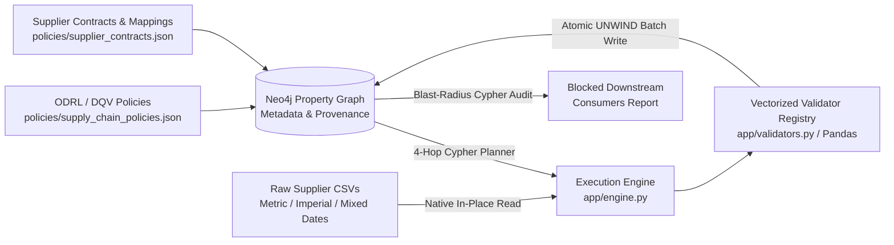
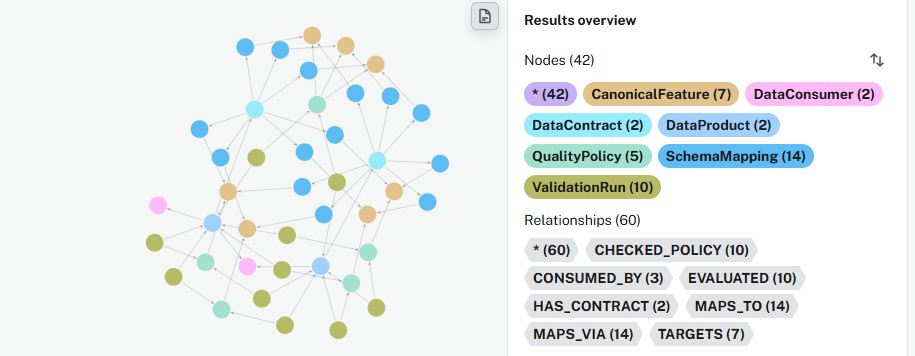

# Supply Chain Data Space Validator (Neo4j + ODRL/DQV)

A lightweight, graph-driven data quality validation engine that decouples declarative governance policies from heterogeneous partner CSV schemas using a **Neo4j Property Graph**, validates native tabular files in place with vectorized **Pandas**, and records full audit provenance and downstream blast radius back into the graph.

## Problem Statement
In multi-vendor ERP and logistics reporting, external suppliers routinely export shipment data with mismatched column headers, mixed measurement units (`kg` vs. `lbs`), and incompatible timestamp formats (ISO-8601 vs. European `DD/MM/YYYY`). Standard enterprise pipelines typically enforce data quality through brittle, supplier-specific ETL scripts that break whenever a partner renames a column or changes an export format.

This repository is an independent, clean-room proof-of-concept exploring a **federated Data Space** alternative:
1. Define data quality policies once in declarative **W3C ODRL / DQV JSON** against a canonical domain model.
2. Store supplier contracts, schema mappings, unit conversion factors, and downstream consumer dependencies in **Neo4j**.
3. Resolve executable validation plans dynamically via multi-hop **Cypher** queries and execute checks directly over native CSV files—avoiding the serialization overhead of converting raw tabular data into RDF triples for SHACL validation.

---

## System Architecture



### Graph Data Model & Multi-Hop Resolution
Rather than hardcoding supplier column names in Python, `app/graph_store.py` traverses a 4-hop semantic path inside Neo4j:

```cypher
(DataProduct)-[:HAS_CONTRACT]->(DataContract)-[:MAPS_VIA]->(SchemaMapping)-[:MAPS_TO]->(CanonicalFeature)<-[:TARGETS]-(QualityPolicy)
```

* **`SchemaMapping` properties** carry supplier-specific normalization metadata (`local_column`, `unit_factor`, `date_format`), allowing a single canonical policy (e.g., `grossWeightKg <= 30,000 kg`) to validate both `gross_wt_kg` (Supplier A) and `weight_lbs` (Supplier B, normalized $\times 0.45359237$).
* **Multi-column policy safety:** Cross-column constraints (such as delivery chronology vs. shipment status) only compile an execution plan when a supplier's contract maps all required canonical features (`WHERE size(mappings) = qp.required_feature_count`).
* **Zero-code extensibility:** Onboarding a new supplier or tightening a threshold requires editing JSON manifests only—zero changes to Python code.

---

## Empirical Validation & Scale Benchmark

Evaluated using a reproducible synthetic multi-supplier generator (`scripts/generate_data.py`, seeded for confidentiality and repeatability):
* **Supplier A (Clean Baseline):** Metric `kg`, ISO-8601 UTC timestamps, 99.8% ID completeness (passes 99.0% SLA across all 5 dimensions).
* **Supplier B (Heterogeneous Feed with Seeded Defects):** Imperial `lbs`, `DD/MM/YYYY HH:MM` dates, plus injected missing tracking IDs, invalid country codes (`UK`, `XX`, `99`), negative/overweight containers, stale sync timestamps (`> 24h`), and broken delivery chronology.

### 500,000-Row Benchmark Results (250,000 Rows per Supplier)

| Stage | 10,000 Rows (Cold Plan) | 500,000 Rows (Warm Plan) | Scaling Characteristic |
| :--- | :---: | :---: | :--- |
| **Cypher Multi-Hop Planner** (10 checks resolved) | `25.06 ms` | **`11.73 ms`** | $O(\text{policies} \times \text{contracts})$ — flat vs. data size |
| **Native CSV Load** (Pandas) | `18.23 ms` | **`498.20 ms`** | Linear I/O scan |
| **In-Place Policy Checks** (5 DQ dimensions × 2 feeds) | `55.17 ms` | **`1,425.67 ms`** | Vectorized columnar evaluation |
| **Neo4j Provenance Write** (`UNWIND` batch) | `1,443.16 ms` *(cold JIT/plan)* | **`32.75 ms`** | Constant single-transaction commit |
| **Total End-to-End Runtime** | **`1,541.62 ms`** | **`1,968.35 ms`** | **< 2.0s for 500K rows** |

### Detected Violations & Blast-Radius Audit (500K Run)
* **Supplier A:** `5 / 5 PASS` (`514` null IDs = `99.79%` completeness $\ge 99.0\%$ SLA).
* **Supplier B:** `5 / 5 FAIL` — Accuracy (`1,250` weight bounds after `lbs -> kg` normalization), Completeness (`6,185` missing IDs), Compliance (`3,745` non-ISO codes), Consistency (`1,250` chronology inversions + `1,250` delivered shipments missing timestamps), Currentness (`12,784` stale rows).
* **Downstream Impact:** Neo4j lineage traversal automatically flagged both **`Enterprise ERP & BI Warehouse [HIGH]`** and **`EU Customs Compliance Gateway [CRITICAL]`** as blocked by Supplier B's failed contract checks.



---

## Engineering & Performance Notes
* **Eliminating N+1 Graph Write Overhead:** An initial implementation persisted each `ValidationRun` inside the check loop (10 separate write transactions over Docker), consuming `1,446 ms`—over 85% of total runtime on 10K rows. Refactoring to a single parameterized Cypher `UNWIND` batch reduced warm provenance writes to **`32.75 ms`** (44× faster), while isolating the one-time Cypher query-plan compilation cost on cold boot.
* **ISO 3166 Veracity Trap:** Supplier exports frequently emit `"UK"` instead of the ISO 3166-1 alpha-2 standard `"GB"`. Explicit set validation surfaces these compliance defects before customs or ERP ingestion.

---

## Design Trade-offs & Scope

| Subsystem | Prototype Implementation | Production-Scale Architecture |
| :--- | :--- | :--- |
| **Validator Dispatch** | Auditable Python `VALIDATOR_REGISTRY` mapped to declarative policy IDs | Pluggable engine adapters (Spark / DuckDB / Polars) selected by dataset size |
| **Tabular Execution** | Single-node in-memory Pandas DataFrames (`~2s` for 500K rows) | Partitioned Parquet streaming via **DuckDB** or **Polars** for multi-GB feeds |
| **Metadata Store** | Single containerized Neo4j 5 Community instance (`docker-compose.yml`) | Clustered Neo4j Aura/Enterprise with role-based access control & policy versioning |
| **Policy Format** | Structured JSON-LD inspired by W3C ODRL & DQV vocabularies | Full JSON-LD compaction/expansion with signed EDC/Gaia-X contract negotiation |

---

## Quick Start

### 1. Start Neo4j Community via Docker Compose
```bash
docker compose up -d
```
Wait until `docker ps` reports `(healthy)`. Neo4j Browser is available at `http://localhost:7474` (`neo4j` / `dataspace123`).

### 2. Install Python Dependencies
```bash
python -m venv venv
pip install -r requirements.txt
```

### 3. Generate Heterogeneous Multi-Supplier CSVs & Run Validation
```bash
# Generate 5,000 rows per supplier (or --rows 250000 for the 500K benchmark)
python scripts/generate_data.py --rows 5000

# Seed Neo4j, resolve Cypher execution plans, validate in place, and run blast-radius audit
python -m app.engine --reset
```

### 4. Inspect the Connected Governance Graph in Neo4j Browser
```cypher
MATCH (n)-[r]->(m) RETURN n, r, m
```

### 5. Run Automated Unit Tests (No Docker Required)
```bash
python -m pytest -v
```

---

## Project Structure
```text
SupplyChain-DataSpace-Validator/
├── docker-compose.yml                # Neo4j 5 Community container with healthcheck
├── requirements.txt                  # neo4j, pandas, pytest
├── policies/
│   ├── supply_chain_policies.json    # Declarative ODRL/DQV quality policies
│   └── supplier_contracts.json       # Supplier schema, unit, date & consumer manifests
├── scripts/
│   └── generate_data.py              # Reproducible heterogeneous CSV generator
├── app/
│   ├── graph_store.py                # Neo4j schema, 4-hop Cypher planner & provenance audit
│   ├── validators.py                 # Vectorized Pandas Validator Registry (5 DQ dimensions)
│   └── engine.py                     # End-to-end validation runner & latency profiler
├── tests/
│   └── test_validator.py             # 6 unit tests covering all DQ rules & unit/date heterogeneity
└── docs/
    └── neo4j_provenance_graph.png    # Neo4j Browser provenance graph capture
```

---

## References
1. Gómez, P., Nadal, S., Romero, O., Queralt, A., & Jovanovic, P. (2025/2026). *Operationalizing and Automating Data Validation in Data Spaces*. Data Science and Engineering.
2. Abelló, A., & Jovanovic, P. *Provenance and Error Traceability in Data Integration & Fusion Pipelines*.
3. W3C Recommendations: *Open Digital Rights Language (ODRL) Information Model 2.2* & *Data Quality Vocabulary (DQV)*.